# [E01a - E04] The Style Warrior - Todo List App

Tugas membuat tampilan **Todo List** menggunakan HTML dan CSS sesuai dengan kriteria.

| Nama                | NRP        |  Kelas     |
| ------------------- | ---------- | ---------- |
| Muhammad Fahmi Ilmi | 5025251141 | PWEB A     |  

<a href="#pembaruan--penjelasan-fitur-versi-e03">Menuju README Versi E03</a> | <a href="#pembaruan--penjelasan-fitur-versi-e04">Menuju README Versi E04</a>

## Deskripsi

### 1. Semantic HTML Elements

Menggunakan beberapa elemen semantic HTML5 seperti `<header>`, `<main>`, `<aside>`, dan `<footer>` untuk membagi struktur halaman.

1. `<header>` saya gunakan sebagai tempat judul utama `<h1>`  
    kutipan kode:

   ```html
   <header>
     <h1>TO-DO LISTKU</h1>
   </header>
   ```

2. `<main>` saya gunakan sebagai tempat untuk panel kiri  
    kutipan kode:
   ```html
   <main class="panel-kiri">
     <section class="list">
       <h2>Daftar Tugas</h2>
       <ul class="todo-list">
         <li class="todo-item">
           <input type="checkbox" checked />
           <div class="todo-info">
             <h3 class="done">Tugas E01A PWEB</h3>
             <span class="badge high">Penting</span>
             <p>Deadline: 14 September 2026</p>
           </div>
         </li>
         <li class="todo-item">
           <input type="checkbox" />
           <div class="todo-info">
             <h3>Tugas KKA BFS, DFS, UCS</h3>
             <span class="badge medium">Sedang</span>
             <p>Deadline: 12 September 2026</p>
           </div>
         </li>
         <li class="todo-item">
           <input type="checkbox" />
           <div class="todo-info">
             <h3>Tugas KPPL Resume</h3>
             <span class="badge low">Ringan</span>
             <p>Deadline: 15 September 2026</p>
           </div>
         </li>
       </ul>
     </section>
   </main>
   ```
3. `<aside>` saya gunakan sebagai tempat untuk panel kanan  
    kutipan kode:
   ```html
   <aside class="panel-kanan">
     <section class="form">
       <h2>Tambah Tugas Baru</h2>
       <form class="todo-form">
         <label for="judul">Judul Tugas</label><br />
         <input
           type="text"
           id="judul"
           placeholder="Masukkan Judul..."
           required
         />
         <br />
         <label for="desc">Deskripsi Tugas</label><br />
         <textarea
           id="desc"
           placeholder="Masukkan Deskripsi..."
           rows="3"
         ></textarea>
         <br />
         <label for="deadline">Deadline</label><br />
         <input type="date" id="deadline" required />
         <br />
         <label>Prioritas</label><br />
         <select required>
           <option selected value="high">Penting</option>
           <option value="medium">Sedang</option>
           <option value="low">Ringan</option>
         </select>
         <button type="submit" title="Tambah Tugas">Tambah Tugas</button>
       </form>
     </section>
   </aside>
   ```
4. `<footer>` saya gunakan sebagai tempat identitas, seperti nama nrp
   kutipan kode:
   ```html
   <footer>
     <p>2026 | MUHAMMAD FAHMI ILMI | 5025251141</p>
   </footer>
   ```

### 2. Layout 2 Panel

Layout utama menggunakan **Flexbox** dan dibagi menjadi dua panel:

- **Panel kiri** untuk menampilkan daftar tugas.  
   kutipan kode:
  ```html
  <main class="panel-kiri">
    <section class="list">
      <h2>Daftar Tugas</h2>
      <ul class="todo-list">
        <li class="todo-item">
          <input type="checkbox" checked />
          <div class="todo-info">
            <h3 class="done">Tugas E01A PWEB</h3>
            <span class="badge high">Penting</span>
            <p>Deadline: 14 September 2026</p>
          </div>
        </li>
        <li class="todo-item">
          <input type="checkbox" />
          <div class="todo-info">
            <h3>Tugas KKA BFS, DFS, UCS</h3>
            <span class="badge medium">Sedang</span>
            <p>Deadline: 12 September 2026</p>
          </div>
        </li>
        <li class="todo-item">
          <input type="checkbox" />
          <div class="todo-info">
            <h3>Tugas KPPL Resume</h3>
            <span class="badge low">Ringan</span>
            <p>Deadline: 15 September 2026</p>
          </div>
        </li>
      </ul>
    </section>
  </main>
  ```
- **Panel kanan** untuk form tambah atau edit tugas.  
   kutipan kode:

  ```html
  <aside class="panel-kanan">
    <section class="form">
      <h2>Tambah Tugas Baru</h2>
      <form class="todo-form">
        <label for="judul">Judul Tugas</label><br />
        <input
          type="text"
          id="judul"
          placeholder="Masukkan Judul..."
          required
        />
        <br />
        <label for="desc">Deskripsi Tugas</label><br />
        <textarea
          id="desc"
          placeholder="Masukkan Deskripsi..."
          rows="3"
        ></textarea>
        <br />
        <label for="deadline">Deadline</label><br />
        <input type="date" id="deadline" required />
        <br />
        <label>Prioritas</label><br />
        <select required>
          <option selected value="high">Penting</option>
          <option value="medium">Sedang</option>
          <option value="low">Ringan</option>
        </select>
        <button type="submit" title="Tambah Tugas">Tambah Tugas</button>
      </form>
    </section>
  </aside>
  ```

  Menggunakan Flexbox supaya tampilan panel bisa kanan kiri.  
   kutipan kode:

  ```css
  .container {
    display: flex;
    gap: 20px;
    max-width: 90%;
    margin: 0 auto;
    padding: 15px;
  }

  .panel-kiri {
    flex: 2;
  }

  .panel-kanan {
    flex: 1;
  }
  ```

  - Panel kiri mengambil ukuran 2 kali ukuran panel kanan. Sehingga panel kiri yang berisi list tugas terlihat lebih lebar.

### 3. Form Input

Panel kanan berisi form untuk memasukkan data tugas, seperti:

- Judul tugas
  ```html
  <label for="judul">Judul Tugas</label><br />
  <input type="text" id="judul" placeholder="Masukkan Judul..." required />
  ```
- Deskripsi
  ```html
  <label for="desc">Deskripsi Tugas</label><br />
  <textarea id="desc" placeholder="Masukkan Deskripsi..." rows="3"></textarea>
  ```
- Deadline
  ```html
  <label for="deadline">Deadline</label><br />
  <input type="date" id="deadline" required />
  ```
- Prioritas tugas
  ```html
  <label>Prioritas</label><br />
  <select required>
    <option selected value="high">Penting</option>
    <option value="medium">Sedang</option>
    <option value="low">Ringan</option>
  </select>
  ```

### 4. Data Statis

Daftar tugas menggunakan data dummy/statis. Setiap tugas memiliki checkbox, judul, deadline, dan tingkat prioritas.

```html
<li class="todo-item">
  <input type="checkbox" checked />
  <div class="todo-info">
    <h3 class="done">Tugas E01A PWEB</h3>
    <span class="badge high">Penting</span>
    <p>Deadline: 14 September 2026</p>
  </div>
</li>
```

### 5. Responsive Design Tampilan dibuat responsive menggunakan `@media
(max-width: 768px)`. Pada layar yang lebih kecil, kedua panel akan berubah
menjadi satu kolom dan form akan berada di bagian atas. 
```css
@media (max-width: 768px) {
    .container {
        flex-direction: column;
    }

    .panel-kanan{
        order: -1;
    }

    .panel-kiri {
        order: 1;
    }
}
```
- Saat di buka di mobile tampilan panel akan menjadi atas bawah. kemudian panel kanan di tampilkan di atas panel kiri dengan mengubah urutannya menggunakan properti `order`.

### 6. External CSS
Style halaman dipisahkan ke dalam file `style.css`, sehingga file HTML hanya
berisi struktur halaman dan file CSS digunakan untuk mengatur tampilan. 
```html
<link rel="stylesheet" href="style.css">
```

## Preview 
- Tampilan Desktop  
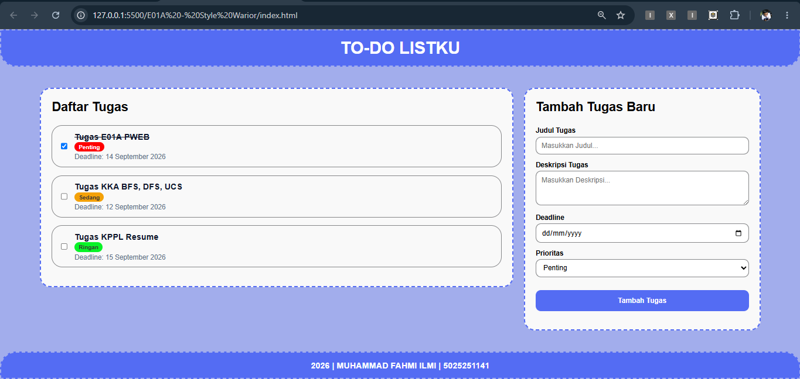

- Tapilan Mobile  
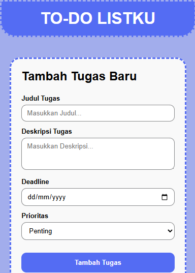  
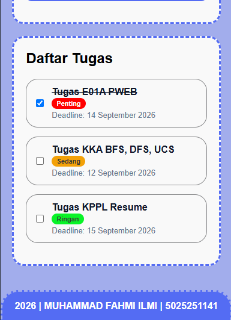


## PENJELASAN KODE JAVASCRIPT  
Kode JavaScript dijalankan setelah seluruh elemen halaman termuat sempurna menggunakan event `DOMContentLoaded`. Berikut adalah rincian bagian kodenya:  

### 1. Inisialisasi & Toggle Dark/Light Mode  
```javascript
document.addEventListener("DOMContentLoaded", () => {
    const form = document.querySelector('.todo-form');
    const todoList = document.querySelector('.todo-list');
    const submitBtn = document.querySelector("button[type='submit']");
    const hero = document.getElementById('add');
    const btnTheme = document.getElementById('btn-theme');

    let todos = [];
    let editingIndex = null;

    btnTheme.addEventListener('click', function(){
        document.body.classList.toggle('dark-mode');

        if(document.body.classList.contains('dark-mode')) btnTheme.textContent = "☀️";
        else btnTheme.textContent = "🌙";
    });
...
```  

Proses inisialisasi (deklarasi variabel) untuk mengambil elemen-elemen HTML ke dalam JavaScript menggunakan metode DOM (Document Object Model) agar bisa dimanipulasi nantinya. kemudian membuat togle darkmode dengan menambah event listener pada elemen ber id `btn-theme` sehingga saat di click akan mengubah tema tampilan web antara mode terang dan gelap (dark mode) dengan memanipulasi kelas CSS `dark-mode` pada elemen <body> serta mengubah ikon tombol.  

### 2. Penanganan Event Form Submit (Tambah & Update Tugas)  
```javascript
form.addEventListener("submit", function(e) {
    e.preventDefault();

    const judul = document.getElementById("judul").value;
    const desc = document.getElementById("desc").value;
    const deadline = document.getElementById("deadline").value;
    const prioritas = document.getElementById("priority").value;

    const todo = {
        judul: judul,
        desc: desc,
        deadline: deadline,
        prioritas: prioritas,
        selesai: false
    };

    if (editingIndex !== null) {
        todos[editingIndex] = todo;
        editingIndex = null;
        submitBtn.textContent = "Tambah Tugas";
        hero.textContent = "Tambah Tugas Baru";
    } else {
        todos.push(todo);
    }

    tampilkanTodos();
    form.reset();
});
```
Penjelasan:  
- `e.preventDefault();` : Perintah wajib untuk mencegah default behavior dari form HTML (yaitu melakukan reload atau refresh halaman secara otomatis saat tombol submit ditekan).   
- Penyimpanan Objek (todo): Nilai input dari form dibungkus terlebih dahulu ke dalam struktur objek JavaScript agar data terorganisir dengan rapi.  
- Jika `editingIndex` tidak bernilai null, artinya aplikasi sedang dalam mode edit, sehingga data pada indeks array tersebut ditimpa (todos[editingIndex] = todo).
- Jika `editingIndex` bernilai null, data objek baru ditambahkan ke dalam array menggunakan metode `.push(todo)`.
- `tampilkanTodos();`: Memanggil fungsi render ulang agar daftar tugas di layar langsung diperbarui secara dinamis tanpa refresh.  
- `form.reset();` : Mengosongkan kembali kolom-kolom input pada form setelah data berhasil diproses.  

### 3. FITUR EDIT DAN HAPUS TUGAS  
#### 3.1. Tombol Hapus  
```javascript 
li.querySelector(".btn-delete").addEventListener("click", function() {
    todos.splice(index, 1);
    tampilkanTodos();
});
```  
Berfungsi untuk menghapus data tugas dari dalam array todos berdasarkan indeksnya menggunakan metode . `splice(index, 1)`. Setelah itu, daftar tugas langsung dirender ulang.  

#### 3.2. Tombol Edit  
```javascript 
li.querySelector(".btn-edit").addEventListener("click", function() {
    editingIndex = index;
    document.getElementById("judul").value = todo.judul;
    document.getElementById("desc").value = todo.desc;
    document.getElementById("deadline").value = todo.deadline;
    document.getElementById("priority").value = todo.prioritas;

    hero.textContent = "Edit Tugas";
    submitBtn.textContent = "Update Tugas";
});
```  
Mengubah judul panel form menjadi "Edit Tugas", merekam elemen `li` tersebut ke dalam variabel `editingItem`, lalu menarik kembali data tugas dari elemen HTML ke dalam kolom-kolom input form di sebelah kanan agar siap diubah oleh pengguna. Tombol submit juga diubah teksnya menjadi "Update Tugas".  

#### 3.3. Checkbox Selesai  
```javascript 
li.querySelector('input[type="checkbox"]').addEventListener("change", function() {
    todo.selesai = this.checked;
    tampilkanTodos();
});
```
Mendeteksi perubahan pada status checkbox (this.checked) dan memperbarui properti selesai pada objek terkait, kemudian memicu render ulang agar kelas CSS .done (efek coret pada teks) diterapkan dengan benar.  

## Tampilan Setelah Ketambah Javascript  
### 1. Tampilan Awal (Light Mode)  
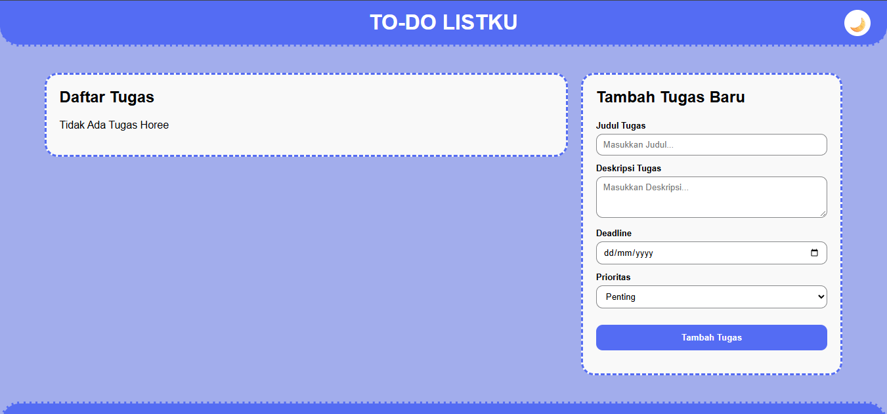  
### 2. Tampilan Awal (Dark Mode)  
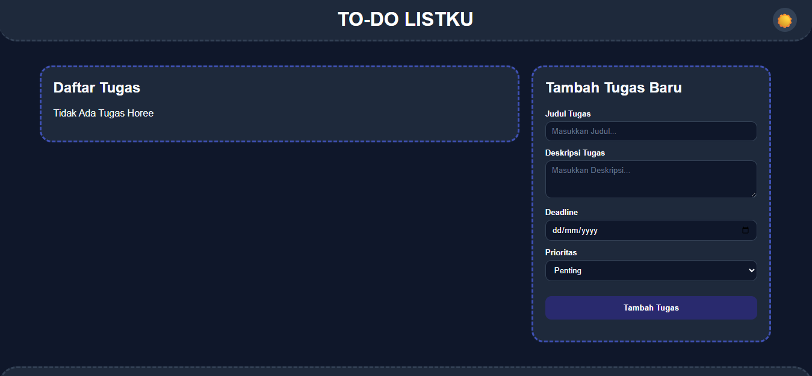  
### 3. Tambah Tugas  
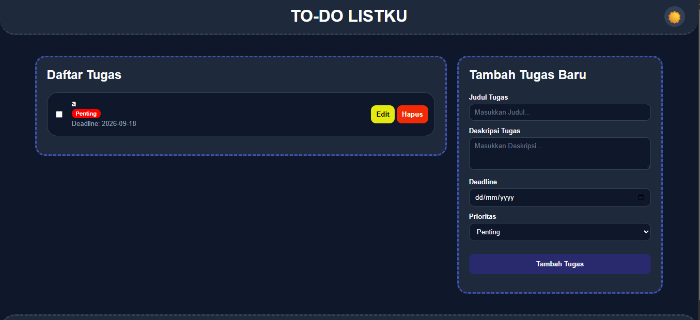  
### 4. Edit Tugas
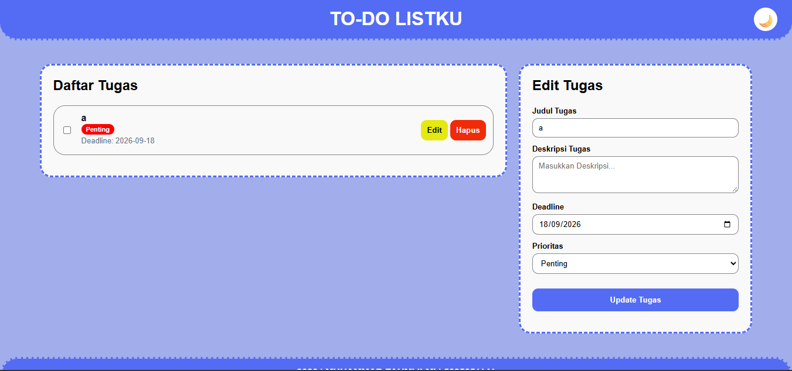

---

## PEMBARUAN & PENJELASAN FITUR VERSI E03

Pada pembaruan versi **E03**, aplikasi Todo List ditingkatkan dengan fitur penyimpanan persisten modern, integrasi perangkat keras (kamera) melalui web API, pemrosesan di latar belakang dan notifikasi (Service Worker), serta penerapan standar aksesibilitas web beserta *best practices*-nya.

Berikut adalah rincian 5 pembaruan utama pada versi E03:

---

### 1. Implementasi Web Storage (IndexedDB & localStorage)
Aplikasi sebelumnya hanya menyimpan data tugas pada memori JavaScript (array sementara) yang akan terhapus saat halaman di-refresh. Pada versi E03, sistem penyimpanan dibagi menjadi dua mekanisme Web Storage sesuai peruntukan datanya:
- **IndexedDB**: Digunakan untuk menyimpan seluruh data Todo List (judul, deskripsi, prioritas, deadline/waktu notifikasi, status selesai, serta lampiran foto dalam format base64). IndexedDB dipilih karena mendukung kapasitas penyimpanan yang besar, transaksi terstruktur, dan pemrosesan asinkron tanpa memblokir antarmuka pengguna.
- **localStorage**: Digunakan untuk menyimpan preferensi pengguna (*user preferences*), yaitu pilihan mode tema (*Light Mode* atau *Dark Mode*), sehingga preferensi tampilan tetap diingat saat pengguna membuka kembali halaman web.

#### 1.1. Inisialisasi dan Pembuatan Object Store IndexedDB
Database IndexedDB diberi nama `TodoDatabase` (versi `1`) dengan object store `todos` dan kunci primer `id` bertipe *autoIncrement*.

*Kutipan kode (`script.js`):*
```javascript
const request = indexedDB.open("TodoDatabase", 1);

request.onerror = function(event) {
    console.log("Error: Gagal Membuka index DB", event.target.error);
};

request.onupgradeneeded = function(event){
    db = event.target.result;
    if(!db.objectStoreNames.contains("todos")){
        db.createObjectStore("todos", {keyPath: "id", autoIncrement: true });
    }
};

request.onsuccess = function(event){
    db = event.target.result;
    tampilkanTodos();
};
```
*Penjelasan:*
- `indexedDB.open("TodoDatabase", 1)`: Membuka koneksi ke database IndexedDB bernama `TodoDatabase`.
- `onupgradeneeded`: Dipicu saat database pertama kali dibuat atau versi skema dinaikkan. Di sini dibuat object store baru bernama `"todos"` dengan kunci `id` yang nilainya otomatis bertambah secara unik (`autoIncrement: true`).
- `onsuccess`: Berjalan setelah database siap digunakan, menyimpan instance database ke variabel `db`, lalu memanggil fungsi `tampilkanTodos()` untuk memuat data tugas ke layar.
- `onerror`: Menangani kemungkinan galat saat membuka database.

#### 1.2. Operasi CRUD dengan Transaksi IndexedDB
Seluruh interaksi data Todo List beralih ke operasi database asinkron:

- **Membaca Data (Read / getAll)**:
  *Kutipan kode (`script.js`):*
  ```javascript
  function tampilkanTodos() {
      if(!db) return;

      let transaction = db.transaction("todos", "readonly");
      let store = transaction.objectStore("todos");
      let requestGetAll = store.getAll();

      requestGetAll.onsuccess = function(event){
          let todos = event.target.result;
          todoList.innerHTML = "";

          if (todos.length === 0) {
              todoList.appendChild(placeHolder);
              return;
          }

          todos.forEach((todo) => {
              // Membuat elemen tugas secara dinamis...
          });
      };
  }
  ```
  *Penjelasan:* Membuka transaksi `"readonly"` pada store `todos` dan memanggil `store.getAll()`. Jika tidak ada data, elemen placeholder "Tidak Ada Tugas Horee" ditampilkan.

- **Menambah Data (Create / add)**:
  *Kutipan kode (`script.js`):*
  ```javascript
  let transaction = db.transaction("todos", "readwrite");
  let store = transaction.objectStore("todos");

  let todoBaru = {
      judul: judul, 
      desc: desc,
      prioritas: prioritas,
      waktuNotif: waktuNotif,
      selesai: false,
      lampiran: capturedImage
  };
  store.add(todoBaru);
  ```
  *Penjelasan:* Membuka transaksi `"readwrite"` untuk menyimpan data tugas baru (termasuk string base64 foto dari kamera) ke dalam store menggunakan `store.add(todoBaru)`.

- **Mengubah Data (Update / put)**:
  *Kutipan kode (`script.js`):*
  ```javascript
  // Update data tugas yang diedit melalui form
  let getReq = store.get(editingIndex);
  getReq.onsuccess = function(event){
      let todoLama = event.target.result;
      let todoBaru = {
          ...todoLama,
          judul: judul,
          desc: desc,
          prioritas: prioritas,
          waktuNotif: waktuNotif,
          lampiran: capturedImage
      };
      store.put(todoBaru);
  };

  // Update status checklist selesai
  li.querySelector('input[type="checkbox"]').addEventListener("change", function() {
      todo.selesai = this.checked;
      let transaction = db.transaction("todos", "readwrite");
      let store = transaction.objectStore("todos");
      let putReq = store.put(todo);

      putReq.onsuccess = function(){
          tampilkanTodos();
      };
  });
  ```
  *Penjelasan:* Menggunakan metode `store.put()` untuk menimpa data tugas yang sudah ada berdasarkan id-nya, baik saat pengguna mengedit teks/lampiran maupun saat mengubah status checkbox selesai.

- **Menghapus Data (Delete / delete)**:
  *Kutipan kode (`script.js`):*
  ```javascript
  li.querySelector(".btn-delete").addEventListener("click", function() {
      let transaction = db.transaction("todos", "readwrite");
      let store = transaction.objectStore("todos");
      let deleteReq = store.delete(todo.id);

      deleteReq.onsuccess = function () {
          tampilkanTodos();
      };
  });
  ```
  *Penjelasan:* Menghapus rekaman tugas secara permanen dari IndexedDB melalui metode `store.delete(todo.id)` dan merender ulang daftar tugas setelah berhasil.

#### 1.3. Penyimpanan Preferensi Tema Menggunakan localStorage
Preferensi tema disimpan di `localStorage` agar dapat langsung dibaca dan diterapkan saat halaman pertama kali dibuka, mencegah efek layar berkedip (*flash of unstyled theme*).

*Kutipan kode (`script.js`):*
```javascript
// Memeriksa preferensi tema tersimpan saat halaman dimuat
const currentTheme = localStorage.getItem("theme");
if(currentTheme === "dark"){
    document.body.classList.add("dark-mode");
    btnTheme.textContent = "☀️";
} else {
    btnTheme.textContent = "🌙";
}

// Menyimpan perubahan preferensi tema saat tombol toggle diklik
btnTheme.addEventListener("click", function() {
    document.body.classList.toggle("dark-mode");
    if (document.body.classList.contains("dark-mode")) {
        localStorage.setItem("theme", "dark");
        btnTheme.textContent = "☀️";
    } else {
        localStorage.setItem("theme", "light");
        btnTheme.textContent = "🌙";
    }
});
```
*Penjelasan:*
- `localStorage.getItem("theme")`: Mengambil nilai tema yang tersimpan sebelumnya (`"dark"` atau `"light"`). Jika bernilai `"dark"`, class `.dark-mode` otomatis disematkan ke elemen `<body>`.
- `localStorage.setItem("theme", "dark" / "light")`: Memperbarui nilai preferensi ke penyimpanan lokal browser setiap kali pengguna mengklik tombol toggle tema.

---

### 2. Implementasi Media Capture API (Kamera & Lampiran Gambar Todo)
Fitur Media Capture API mengizinkan pengguna untuk mengambil foto secara langsung melalui kamera perangkat (webcam laptop atau kamera ponsel) untuk dilampirkan ke dalam catatan tugas.

#### 2.1. Penambahan Elemen Kamera dan Lampiran pada Form
Pada panel kanan (`form`), ditambahkan elemen `<video>` untuk live preview kamera, elemen `<canvas>` untuk proses pengambilan foto, serta tombol interaktif untuk kontrol kamera.

*Kutipan kode HTML (`index.html`):*
```html
<label for="addLampiran">Tambahkan Lampiran</label><br>
<br>
<video id="cameraVideo" autoplay playsinline style="width: 100%; max-width: 300px; display: none; border-radius: 10px; margin-bottom: 10px;"></video>
<canvas id="cameraCanvas" style="display: none;"></canvas>
<button id="addLampiran" type="button" title="Take Picture">Take Picture</button>
```
*Penjelasan:*
- `<video id="cameraVideo">`: Menampilkan umpan video langsung (*live stream*) dari kamera. Atribut `playsinline` memastikan video berjalan langsung di dalam halaman pada peramban mobile tanpa membuka pemutar layar penuh sistem operasi.
- `<canvas id="cameraCanvas">`: Berfungsi untuk menangkap satu frame gambar diam (*still frame capture*) dari video dan mengonversinya menjadi data gambar.
- `<button id="addLampiran">`: Tombol kontrol dinamis yang melayani aksi membuka kamera, mengambil gambar, atau mengambil ulang foto.

#### 2.2. Mengakses Kamera dengan `navigator.mediaDevices.getUserMedia`
*Kutipan kode JavaScript (`script.js`):*
```javascript
function startCamera(){
    navigator.mediaDevices.getUserMedia({ video: true, audio: false })
    .then(stream => {
        videoElement.srcObject = stream;
        videoElement.style.display = 'block'; 
        videoElement.play();

        cameraCanvas.style.display = 'none';
        addLampiranBtn.textContent = "Take Picture"; 
    })
    .catch(err => {
        console.error("Gagal mengakses kamera: ", err);
        alert("Tidak dapat mengakses kamera. Pastikan izin kamera diizinkan.");
    });
}
```
*Penjelasan:*
- `navigator.mediaDevices.getUserMedia({ video: true, audio: false })`: Meminta izin kepada pengguna untuk mengaktifkan sensor kamera video tanpa audio.
- `videoElement.srcObject = stream`: Memasukkan stream video langsung ke elemen `<video>`.
- Jika hak akses kamera ditolak oleh pengguna atau perangkat tidak mendukung, blok `.catch` akan menangani galat dan menampilkan pesan alert yang jelas.

#### 2.3. Menangkap Frame Foto & Menghentikan Stream Kamera
*Kutipan kode JavaScript (`script.js`):*
```javascript
addLampiranBtn.addEventListener('click', () => {
    const stream = videoElement.srcObject;
    const isCameraActive = stream && videoElement.style.display !== 'none';

    if (!isCameraActive) {
        startCamera();
    } else {
        const context = cameraCanvas.getContext('2d');
        if(width && height){
            cameraCanvas.width = width;
            cameraCanvas.height = height;
            context.drawImage(videoElement, 0, 0, width, height);
            const data = cameraCanvas.toDataURL('image/png');

            cameraCanvas.style.display = 'block';
            capturedImage = data;

            // Hentikan hardware kamera demi privasi dan hemat daya
            stream.getTracks().forEach(track => track.stop());
            videoElement.srcObject = null;
            videoElement.style.display = 'none';

            addLampiranBtn.textContent = "Ambil Ulang Foto / Buka Kamera";
        }
    }
});
```
*Penjelasan:*
- `context.drawImage(videoElement, 0, 0, width, height)`: Menggambar frame dari video ke atas canvas 2D dengan dimensi proporsional 300x240 piksel.
- `cameraCanvas.toDataURL('image/png')`: Mengubah hasil gambar canvas ke representasi string Data URL base64 berformat PNG. String inilah yang disimpan ke variabel `capturedImage` dan nantinya dimasukkan ke IndexedDB.
- `track.stop()`: Menghentikan track perangkat keras kamera agar lampu indikator kamera mati setelah pemotretan selesai, menjaga privasi pengguna serta menghemat konsumsi daya.

#### 2.4. Menampilkan Gambar Lampiran pada Daftar Tugas
Pada tampilan daftar tugas, foto lampiran disajikan menggunakan elemen HTML5 semantik `<details>` dan `<summary>` yang dapat dibuka-tutup secara fleksibel:

*Kutipan kode (`script.js`):*
```javascript
${todo.lampiran ? `
    <details style="margin-top: 8px;">
        <summary style="cursor: pointer; font-size: 12px; font-weight: bold; color: #546cf3;">Lihat Lampiran</summary>
        
    </details>
` : ""}
```

---

### 3. Implementasi Service Worker & Waktu Notifikasi Todo
Untuk mendukung kinerja aplikasi modern serta menyediakan pengingat tenggat waktu (*reminders*), aplikasi mengintegrasikan **Service Worker** (`sw.js`) dan **Web Notification API**.

#### 3.1. Penambahan Field Waktu Notifikasi / Deadline pada Form
Field batas waktu tugas diperbarui dari input tanggal biasa (`date`) menjadi input tanggal dan waktu (`datetime-local`).

*Kutipan kode HTML (`index.html`):*
```html
<label for="waktuNotif">Deadline</label><br>
<input type="datetime-local" id="waktuNotif" required/><br>
```
*Penjelasan:* Elemen `<input type="datetime-local">` memungkinkan pengguna menentukan tanggal dan jam target selesai tugas secara spesifik, yang nantinya dijadikan acuan waktu notifikasi pengingat.

#### 3.2. Pendaftaran Service Worker & Permintaan Izin Notifikasi
Saat aplikasi dibuka pertama kali, aplikasi mendaftarkan berkas `sw.js` dan meminta izin notifikasi browser kepada pengguna.

*Kutipan kode JavaScript (`script.js`):*
```javascript
if('serviceWorker' in navigator){
    navigator.serviceWorker.register('sw.js')
        .then(reg => console.log('Service worker berhasil didaftarkan: ', reg.scope))
        .catch(err => console.error('Service Worker Gagal', err));
}

async function requestNotificationPermission(){
    const result = await Notification.requestPermission();
    if(result === 'denied'){
        console.log('Izin Notifikasi ditolak');
        return;
    }
    console.log('notifikasi diizinkan');
}

if('Notification' in window){
    requestNotificationPermission();
}
```
*Penjelasan:*
- `navigator.serviceWorker.register('sw.js')`: Mendaftarkan Service Worker pada root scope aplikasi.
- `Notification.requestPermission()`: Menampilkan dialog izin notifikasi peramban kepada pengguna agar sistem operasi diizinkan memunculkan notifikasi desktop/mobile.

#### 3.3. Logika Pemrosesan pada Service Worker (`sw.js`)
Service Worker berjalan pada utas latar belakang (*background thread*) dan mendengarkan event pesan dari aplikasi utama melalui listener `message`.

*Kutipan kode (`sw.js`):*
```javascript
self.addEventListener('install', (event) => {
    console.log('Service Worker terinstal.');
    self.skipWaiting();
});

self.addEventListener('activate', (event) => {
    console.log('Service Worker aktif.');
});

self.addEventListener('message', (event) => {
    if (event.data) {
        const { type, judul, desc } = event.data;
        
        let title = '';
        let options = {};

        if (type === 'NEW_TODO') {
            title = 'Todo Baru telah ditambahkan!';
            options = {
                body: `Judul: ${judul}\n${desc ? 'Deskripsi: ' + desc : 'Segera selesaikan tugasmu.'}`
            };
        } else if (type === 'REMINDER') {
            title = `Pengingat Tugas: ${judul}`;
            options = {
                body: desc || 'Waktunya mengerjakan tugas ini sesuai jadwal!'
            };
        }

        self.registration.showNotification(title, options);
    }
});
```
*Penjelasan:*
- `self.skipWaiting()`: Memaksa Service Worker baru segera aktif tanpa menunggu sesi peramban ditutup.
- `self.addEventListener('message', ...)`: Menerima payload data dari halaman utama. Berdasarkan atribut `type`:
  - `NEW_TODO`: Memunculkan notifikasi instan bahwa tugas baru berhasil didaftarkan.
  - `REMINDER`: Memunculkan notifikasi peringatan menjelang tenggat waktu tugas.
- `self.registration.showNotification(title, options)`: Memanggil API notifikasi asli sistem operasi untuk memunculkan pesan visual kepada pengguna.

#### 3.4. Notifikasi Instan dan Penjadwalan Pengingat Otomatis
*Kutipan kode JavaScript (`script.js`):*
```javascript
// Notifikasi saat tugas baru berhasil disimpan
function triggerNewTaskNotification(judul, desc) {
    if (navigator.serviceWorker.controller) {
        navigator.serviceWorker.controller.postMessage({
            type: 'NEW_TODO',
            judul: judul,
            desc: desc
        });
    }
}

// Penjadwalan pengingat otomatis 10 menit sebelum deadline
function scheduleNotification(judul, desc, waktuNotif) {
    if (!waktuNotif) return;
    const targetTime = new Date(waktuNotif).getTime();
    const now = new Date().getTime();
    const tenMinutesBefore = targetTime - (10 * 60 * 1000);
    const delay = tenMinutesBefore - now;

    if (delay > 0) {
        setTimeout(() => {
            if (navigator.serviceWorker.controller) {
                navigator.serviceWorker.controller.postMessage({
                    type: 'REMINDER',
                    judul: judul,
                    desc: `Pengingat: 10 menit lagi menuju waktu ${waktuNotif.replace('T', ' ')}`
                });
            }
        }, delay);
    }
}
```
*Penjelasan:*
- `triggerNewTaskNotification`: Mengirim pesan berjenis `'NEW_TODO'` ke Service Worker sesaat setelah tugas ditambahkan ke database.
- `scheduleNotification`: Menghitung waktu 10 menit sebelum tenggat (`targetTime - (10 * 60 * 1000)`). Jika waktu pengingat berada di masa mendatang (`delay > 0`), disetel pengatur waktu `setTimeout` yang otomatis mengirim pesan `'REMINDER'` ke Service Worker saat waktunya tiba.

---

### 4. Implementasi Aksesibilitas (Accessibility) pada Seluruh Komponen
Aksesibilitas web menjamin bahwa seluruh pengguna—termasuk penyandang disabilitas yang menggunakan teknologi pembaca layar (*screen reader*)—dapat mengakses dan menggunakan seluruh komponen aplikasi dengan mudah.

#### 4.1. Bahasa Dokumen & Elemen Landmark Semantik
*Kutipan kode HTML (`index.html`):*
```html
<!DOCTYPE html>
<html lang="id">
<head> ... </head>
<body>
    <nav aria-label="Pintasan Navigasi" class="skip-links"> ... </nav>
    <header> ... </header>
    <div class="container">
        <main class="panel-kiri"> ... </main>
        <aside class="panel-kanan" aria-label="add"> ... </aside>
    </div>
    <footer> ... </footer>
</body>
</html>
```
*Penjelasan:*
- Atribut `lang="id"`: Menginstruksikan screen reader untuk menggunakan modul pelafalan Bahasa Indonesia, sehingga kata-kata dibacakan secara natural dan benar.
- Elemen Landmark (`<nav>`, `<header>`, `<main>`, `<aside>`, `<footer>`): Membagi halaman ke dalam wilayah struktural formal, memudahkan pengguna screen reader melompat langsung ke bagian halaman tertentu menggunakan navigasi landmark.

#### 4.2. Accessible Name pada Tombol Emoji & Form Inputs
*Kutipan kode HTML (`index.html`):*
```html
<!-- Tombol ikonik yang diberi aria-label deskriptif -->
<button type="button" id="btn-theme" aria-label="Ubah Mode tampilan Gelap atau Terang">🌙</button>

<!-- Label terhubung eksplisit dengan atribut for dan id -->
<label for="judul">Judul Tugas</label><br>
<input type="text" id="judul" placeholder="Masukkan Judul..." required/>

<label for="desc">Deskripsi Tugas</label><br>
<textarea id="desc" placeholder="Masukkan Deskripsi..." rows="3"></textarea>

<label for="waktuNotif">Deadline</label><br>
<input type="datetime-local" id="waktuNotif" required/><br>

<label for="priority">Prioritas</label><br>
<select id="priority" required> ... </select>

<label for="addLampiran">Tambahkan Lampiran</label><br>
<button id="addLampiran" type="button" title="Take Picture">Take Picture</button>

<div class="submitContainer">
    <button type="submit" title="Tambah Tugas">Tambah Tugas</button>
    <button type="button" id="batalBtn" title="Batal" hidden>Batal</button>
</div>
```
*Penjelasan:*
- Atribut `aria-label="Ubah Mode tampilan Gelap atau Terang"`: Memberikan nama aksesibel pada tombol tema yang hanya berisi ikon emoji, mencegah pembaca layar membaca karakter mentah emoji.
- Pasangan atribut `for` pada `<label>` dan `id` pada kontrol form: Menghubungkan teks keterangan secara langsung dengan elemen input, mempermudah identifikasi form oleh teknologi bantu dan memperbesar area sentuh klik pada label.
- Atribut `title` dan `type` eksplisit: Setiap tombol memiliki atribut `type="button"` atau `type="submit"` serta atribut `title` yang memberikan kejelasan peran (*role*) dan deskripsi fungsi tombol.

#### 4.3. Hubungan Heading dan Kontainer melalui `aria-labelledby`
*Kutipan kode HTML (`index.html`):*
```html
<section class="list" aria-labelledby="heading-tugas">
    <h2 id="heading-tugas" tabindex="-1">Daftar Tugas</h2>
    <ul class="todo-list" aria-live="polite">
        <p id="placehold">Tidak Ada Tugas Horee</p>
    </ul>
</section>
```
*Penjelasan:*
- `aria-labelledby="heading-tugas"`: Memberikan nama aksesibel pada elemen `<section class="list">` yang diambil langsung dari teks judul `<h2>`, sehingga screen reader dapat mengumumkan wilayah tersebut sebagai section "Daftar Tugas".
- `tabindex="-1"` pada `<h2>`: Memungkinkan heading untuk menerima fokus terprogram dari skip-link tanpa mengacaukan urutan tab alami pengguna.

#### 4.4. Pembaruan Dinamis dengan ARIA Live Region (`aria-live="polite"`)
*Kutipan kode HTML (`index.html`):*
```html
<ul class="todo-list" aria-live="polite">
```
*Penjelasan:*
- Atribut `aria-live="polite"`: Menetapkan kontainer daftar tugas sebagai *live region*. Saat tugas baru ditambahkan, dihapus, atau statusnya dicentang via JavaScript, perubahan tersebut langsung dibacakan oleh screen reader secara santun (*polite*) tanpa memotong pembacaan instruksi yang sedang berlangsung.

---

### 5. Penerapan Best Practices Kriteria Aksesibilitas (WCAG Compliance)
Aplikasi Todo List menerapkan praktik terbaik (*best practices*) aksesibilitas sesuai pedoman **WCAG (Web Content Accessibility Guidelines)**:

#### 5.1. Implementasi Skip Links (Pintasan Navigasi Keyboard)
Bagi pengguna yang menavigasi website hanya dengan keyboard (tanpa mouse), *Skip Links* sangat krusial agar mereka tidak perlu menekan tombol `Tab` berulang-ulang melewati header untuk mencapai konten utama.

*Kutipan kode HTML (`index.html`):*
```html
<nav aria-label="Pintasan Navigasi" class="skip-links">
    <a href="#heading-tugas" class="skip-link">Lewati ke Daftar Tugas</a>
    <a href="#judul" class="skip-link">Lewati ke Form Tambah Tugas</a>
</nav>
```

*Kutipan kode CSS (`style.css`):*
```css
.skip-links {
    position: absolute;
    top: 0;
    left: 0;
    z-index: 1000;
}

.skip-link {
    position: absolute;
    width: 1px;
    height: 1px;
    padding: 0;
    margin: -1px;
    overflow: hidden;
    clip: rect(0, 0, 0, 0);
    white-space: nowrap;
    border: 0;
}

.skip-link:focus {
    position: static;
    width: auto;
    height: auto;
    padding: 8px 16px;
    margin: 10px;
    overflow: visible;
    clip: auto;
    white-space: normal;
    background: #2563eb;
    color: #ffffff;
    font-weight: bold;
    border-radius: 4px;
    outline: 3px solid #ffeb3b;
    display: inline-block;
}
```
*Penjelasan:*
- Teknik *visually-hidden* standar (`clip: rect(0, 0, 0, 0)`, `width: 1px`): Tautan disembunyikan dari pandangan pengguna biasa agar tidak mengganggu layout, tetapi tetap tersedia untuk pembaca layar.
- Keadaan fokus `:focus`: Ketika pengguna menekan tombol `Tab` pertama kali di browser, tombol skip link seketika muncul di pojok kiri atas dengan latar belakang biru cerah (`#2563eb`) dan outline kontras tinggi berwarna kuning (`#ffeb3b`), memberikan indikator fokus visual yang sangat tegas.

#### 5.2. Navigasi Penuh Menggunakan Keyboard & Manajemen Fokus
- **Dukungan Keyboard 100%**: Pengguna dapat menggunakan tombol `Tab` dan `Shift + Tab` untuk berpindah antar seluruh komponen interaktif secara urut, tombol `Space` untuk mencentang checkbox dan membuka/menutup lampiran, serta tombol `Enter` untuk menjalankan tombol aksi dan mengirim form.
- **Manajemen Fokus Tombol Batal**:
  ```html
  <button type="button" id="batalBtn" title="Batal" hidden>Batal</button>
  ```
  Tombol batal menggunakan atribut standar HTML `hidden`. Ketika tidak dalam mode edit, tombol benar-benar dihapus dari pohon aksesibilitas (*accessibility tree*) sehingga tidak dapat difokuskan oleh tombol `Tab` keyboard secara tidak sengaja.

#### 5.3. Standar Rasio Kontras Warna (Color Contrast WCAG AA)
- Warna latar belakang dan teks pada mode terang maupun gelap dirancang memiliki rasio kontras yang memenuhi standar minimum WCAG AA (minimal 4.5:1 untuk teks biasa):
  *Kutipan kode CSS (`style.css`):*
  ```css
  /* Status badge prioritas kontras tinggi */
  .badge.high {
      background-color: red;
      color: #ffff;
  }
  .badge.medium {
      background-color: #c94102;
      color: #f0ecec;
  }
  .badge.low {
      background-color: #023d0a;
      color: #f8f4f4;
  }

  /* Mode gelap dengan warna teks kontras */
  body.dark-mode {
      background-color: #0f172a; 
      color: #f8fafc;
  }
  body.dark-mode .todo-info h3 {
      color: #f8fafc;
  }
  body.dark-mode .todo-info p {
      color: #94a3b8;
  }
  ```
- **Prinsip *Not Color-Alone***: Status tugas selesai tidak hanya dibedakan berdasarkan perubahan warna teks, melainkan disertai garis coret (`text-decoration: line-through`) dan status centang checkbox native (`checked`) yang dibacakan secara gamblang oleh screen reader ("dicentang" / "tidak dicentang").

#### 5.4. Aksesibilitas Gambar & Komponen Interaktif Native
- Setiap gambar lampiran tugas memiliki atribut `alt="Lampiran Tugas"`:
  ```html
  
  ```
- Penggunaan elemen HTML5 bawaan `<details>` dan `<summary>` untuk lampiran foto memastikan fungsi buka-tutup lampiran dapat dioperasikan secara bawaan via tombol `Enter` atau `Space` tanpa memerlukan skrip JavaScript khusus.  

## Tampilan Setelah Pembaruan E03  
### 1. Tampilan Fitur Capture   
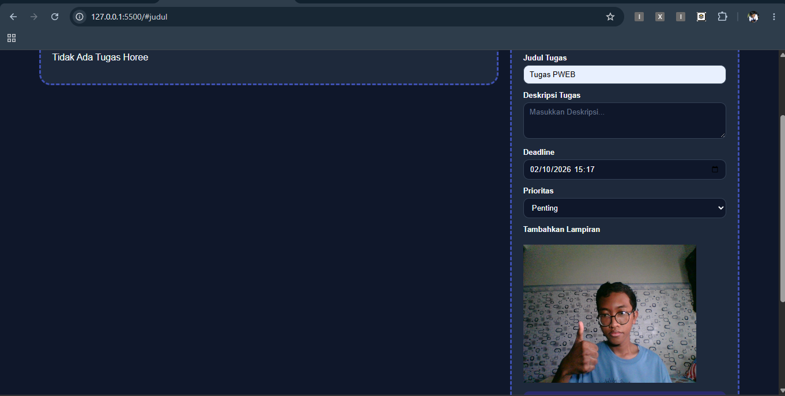  
### 2. Tampilan Detail Gambar Hasil Capture  
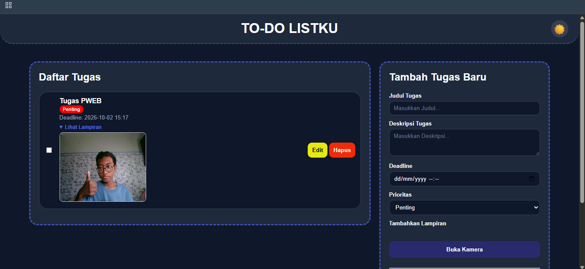  
### 3. Tampilan Hasil Penyimpanan di IndexedDB  
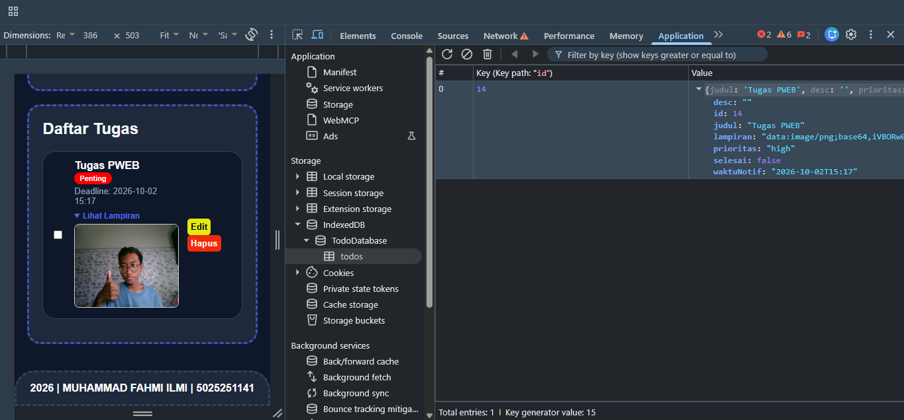  
### 4. Tampilan Hasil Preferensi tema di LocalStorage  
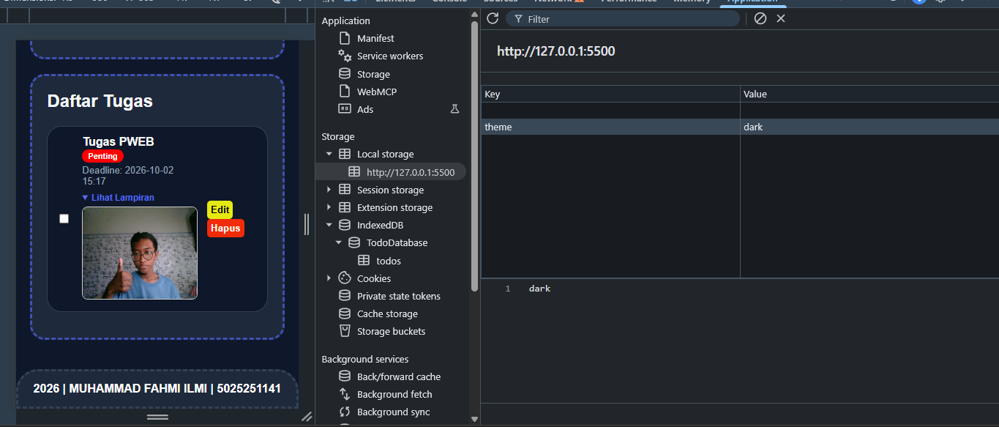  
### 5. Tampilan pintasan link aksesibilatas saat Tab  
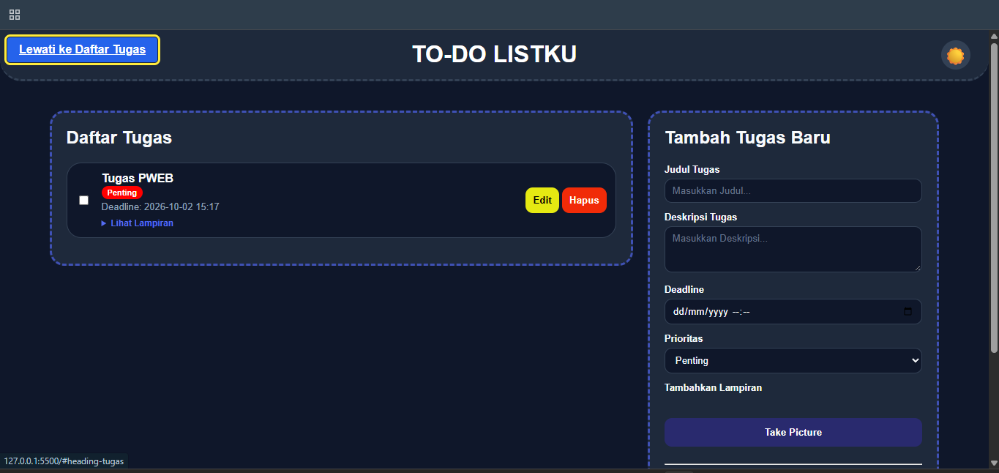  
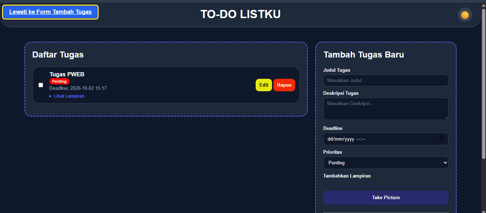  
### 6. Tampilan Hasil Notifikasi service worker  
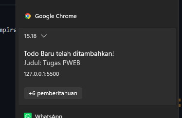  

---

## PEMBARUAN & PENJELASAN FITUR VERSI E04

---

### 1. Implementasi Menu Bar / Navigasi (Personal & Shared)
Fitur navigasi menu bar ditambahkan untuk memisahkan tugas ke dalam dua menu utama, yaitu **Personal** dan **Shared**:
- **Menu Personal**: Menampilkan daftar tugas pribadi yang dimiliki khusus oleh pengguna/perangkat yang sedang aktif berdasarkan identifikasi akun pengguna (`user_id = $current_user_id`).
- **Menu Shared**: Menampilkan daftar tugas bersama (publik/kolaboratif) yang dapat dilihat, ditambah, diselesaikan, atau dihapus oleh seluruh pengguna.

#### 1.1. Komponen Navigasi Menu Bar (`menu-bar.php`)
Komponen navigasi menu bar dipisahkan ke dalam modul tersendiri.

*Kutipan kode (`menu-bar.php`):*
```php
<div class="main-nav" style="max-width: 1200px; margin: 0 auto 20px auto; padding: 0 20px; display: flex; gap: 10px;">
    <a href="index.php?menu=personal" class="tab-btn <?= $kategori === 'personal' ? 'active' : ''; ?>">Personal</a>
    <a href="index.php?menu=shared" class="tab-btn <?= $kategori === 'shared' ? 'active' : ''; ?>">Shared</a>
</div>
```
*Penjelasan:*
- `index.php?menu=personal` & `index.php?menu=shared`: Menggunakan query parameter HTTP GET (`?menu=...`) untuk berpindah kategori.
- `<?= $kategori === 'personal' ? 'active' : ''; ?>`: Operator ternary PHP yang mengevaluasi kategori aktif. Jika menu yang dipilih sesuai dengan nilai variabel `$kategori`, kelas CSS `.active` disematkan untuk memberikan penanda visual tab aktif.

#### 1.2. Filter Query Berdasarkan Menu Aktif (`index.php`)
Pada berkas utama, nilai kategori dibaca dari parameter GET dan menentukan kueri SQL yang dieksekusi:

*Kutipan kode (`index.php`):*
```php
$kategori = isset($_GET['menu']) ? $_GET['menu'] : 'personal';

...

if($kategori === 'personal'){
    $query = "SELECT * FROM todos WHERE kategori = 'personal' AND user_id = $current_user_id";
} else {
    $query = "SELECT * FROM todos WHERE kategori = 'shared'";
}
$result = mysqli_query($conn, $query);
```
*Penjelasan:*
- `isset($_GET['menu']) ? $_GET['menu'] : 'personal'`: Memeriksa parameter URL. Jika pengguna pertama kali membuka halaman tanpa parameter, sistem secara bawaan membuka menu `'personal'`.
- Kondisi `'personal'`: Menyeleksi hanya tugas berkategori personal milik pengguna aktif (`user_id = $current_user_id`).
- Kondisi `'shared'`: Menyeleksi seluruh tugas berkategori bersama tanpa membatasi `user_id`.

---

### 2. Migrasi Kode HTML ke PHP dan Desain Modular

Berikut adalah struktur berkas yang dibuat:
1. `config.php`: Modul koneksi database dan inisialisasi sesi pengguna.
2. `header.php`: Modul bagian atas halaman (tag `<head>`, judul dinamis, skip-link aksesibilitas, dan tombol dark mode).
3. `menu-bar.php`: Modul navigasi tab Personal dan Shared.
4. `index.php`: Modul konten utama yang menggabungkan seluruh komponen antarmuka, menampilkan daftar tugas, dan menyediakan formulir tugas.
5. `footer.php`: Modul penutup halaman (identitas pembuat dan pemanggilan berkas JavaScript).
6. Berkas Aksi Pemrosesan: `proses.php`, `hapus.php`, dan `update-status.php` yang menangani logika manipulasi data secara terpisah dari tampilan.

#### 2.1. Konfigurasi Database & Auto User Identification (`config.php`)
Berkas ini bertugas membuka koneksi ke server MySQL sekaligus mendeteksi identitas pengguna unik perangkat menggunakan Cookie browser.

*Kutipan kode (`config.php`):*
```php
<?php
$host = "localhost:3307";
$user = "root";
$pass = "";
$db = "db_todo";

$conn = mysqli_connect($host, $user, $pass, $db);
if(!$conn){
    die("Koneksi gagal " . mysqli_connect_error());
}

if(!isset($_COOKIE['device_user_id'])){
    $unique_name = "User_" . substr(md5(mt_rand()), 0, 6);

    $insert_user = "INSERT INTO users(username, nama_lengkap) VALUES ('$unique_name', '$unique_name')";
    mysqli_query($conn, $insert_user);

    $new_user_id = mysqli_insert_id($conn);

    setcookie('device_user_id', $new_user_id, time() + (86400 * 30), "/");
    $current_user_id = $new_user_id;
} else {
    $current_user_id = intval($_COOKIE['device_user_id']);
}
?>
```
*Penjelasan:*
- `mysqli_connect(...)`: Menghubungkan aplikasi ke database MySQL `db_todo` pada port 3307.
- `if(!isset($_COOKIE['device_user_id']))`: Memeriksa apakah perangkat pengguna sudah memiliki pengenal unik. Jika belum ada, sistem secara otomatis:
  1. Membuat nama acak unik (misalnya `14`) menggunakan fungsi hash `md5(mt_rand())`.
  2. Mendaftarkan akun tersebut ke tabel `users`.
  3. Mengambil ID akun yang baru saja dibuat dengan `mysqli_insert_id($conn)`.
  4. Menyimpan ID tersebut ke dalam Cookie peramban dengan masa berlaku 30 hari (`time() + (86400 * 30)`).
  5. Menetapkan ID ke variabel `$current_user_id`.
  Dengan mekanisme ini, pengguna dapat langsung menggunakan fitur personal.

#### 2.2. Modul Header (`header.php`)
Memuat konfigurasi metadata HTML serta judul halaman yang menyesuaikan menu yang sedang aktif.

*Kutipan kode (`header.php`):*
```php
<?php
$kategori = isset($_GET['menu']) ? $_GET['menu'] : 'personal';
?>
<!DOCTYPE html>
<html lang="id">
<head>
    <meta charset="UTF-8">
    <meta name="viewport" content="width=device-width, initial-scale=1.0">
    <title>TO DO LIST - <?= ucfirst($kategori); ?></title>
    <link rel="stylesheet" href="style.css">
</head>
<body>
    <nav aria-label="Pintasan Navigasi" class="skip-links">
        <a href="#heading-tugas" class="skip-link">Lewati ke Daftar Tugas</a>
        <a href="#judul" class="skip-link">Lewati ke Form Tambah Tugas</a>
    </nav>

    <header>
        <h1>TO-DO LISTKU</h1>
        <button type="button" id="btn-theme" aria-label="Ubah Mode tampilan Gelap atau Terang">🌙</button>
    </header>
```
*Penjelasan:*
- `<title>TO DO LIST - <?= ucfirst($kategori); ?></title>`: Menggunakan fungsi bawaan PHP `ucfirst()` agar huruf awal kategori menjadi kapital secara dinamis pada judul tab browser (misal: "TO DO LIST - Personal").
- Struktur aksesibilitas seperti `<nav class="skip-links">` dan tombol tema tetap dipertahankan dari versi E03.

#### 2.3. Penggabungan Modul pada Berkas Utama (`index.php`)
Seluruh modul dirakit secara `include`:

*Kutipan kode (`index.php`):*
```php
<?php
include 'config.php';

$kategori = isset($_GET['menu']) ? $_GET['menu'] : 'personal';

$edit_data = null;
if(isset($_GET['edit_id'])){
    $edit_id = intval($_GET['edit_id']);
    $edit_query = mysqli_query($conn, "SELECT * FROM todos WHERE id = $edit_id");
    $edit_data = mysqli_fetch_assoc($edit_query);
}

if($kategori === 'personal'){
    $query = "SELECT * FROM todos WHERE kategori = 'personal' AND user_id = $current_user_id";
} else {
    $query = "SELECT * FROM todos WHERE kategori = 'shared'";
}
$result = mysqli_query($conn, $query);

include 'header.php';
include 'menu-bar.php';
?>
...
<!-- Konten Dua Panel (Daftar Tugas dan Formulir Tugas) -->
...
<?php include 'footer.php'; ?>
```

---

### 3. Struktur Database Relasional & Berkas SQL (`data.sql`)

#### 3.1. Skema Database (`data.sql`)

*Kutipan kode (`data.sql`):*
```sql
CREATE DATABASE IF NOT EXISTS db_todo;
USE db_todo;

CREATE TABLE IF NOT EXISTS users (
    id INT AUTO_INCREMENT PRIMARY KEY,
    username VARCHAR(50) NOT NULL,
    nama_lengkap VARCHAR(100) NOT NULL
);

CREATE TABLE IF NOT EXISTS todos (
    id INT AUTO_INCREMENT PRIMARY KEY,
    user_id INT,
    judul VARCHAR(255) NOT NULL,
    deskripsi TEXT,
    waktu_notif DATETIME,
    prioritas ENUM('high', 'medium', 'low') DEFAULT 'high',
    lampiran LONGTEXT,
    selesai BOOLEAN DEFAULT 0,
    kategori ENUM('personal', 'shared') DEFAULT 'personal',
    FOREIGN KEY (user_id) REFERENCES users(id) ON DELETE CASCADE
);
```
*Penjelasan Kolom & Relasi:*
1. **Tabel `users`**:
   - `id`: Kunci primer (*Primary Key*) bertipe integer auto-increment untuk identifikasi unik setiap pengguna.
   - `username`: Nama unik pengenal pengguna.
   - `nama_lengkap`: Nama lengkap akun.
2. **Tabel `todos`**:
   - `id`: Kunci primer bertipe integer auto-increment untuk setiap item catatan tugas.
   - `user_id`: Kunci tamu (*Foreign Key*) yang mereferensikan kolom `id` pada tabel `users`.
   - `judul`: Judul tugas (`VARCHAR(255)`).
   - `deskripsi`: Keterangan detail tugas bertipe teks panjang (`TEXT`).
   - `waktu_notif`: Batas tenggat waktu dan jadwal pengingat bertipe `DATETIME`.
   - `prioritas`: Tingkat urgensi menggunakan tipe `ENUM('high', 'medium', 'low')`.
   - `lampiran`: Menyimpan data berkas foto tangkapan kamera dalam format string Base64 dengan tipe data kapasitas besar `LONGTEXT` (mampu menampung hingga 4 GB).
   - `selesai`: Nilai boolean (`0` untuk belum selesai, `1` untuk selesai).
   - `kategori`: Kategori ruang lingkup tugas bertipe `ENUM('personal', 'shared')`.
   - `FOREIGN KEY (user_id) REFERENCES users(id) ON DELETE CASCADE`: Menjaga integritas referensial. Apabila baris data pengguna pada tabel `users` dihapus, seluruh data tugas personal miliknya di tabel `todos` otomatis ikut terhapus.
--- 

#### 3.2. Impor Basis Data ke MySQL
1. **Melalui phpMyAdmin**: Buka menu tab *Import*, pilih berkas `data.sql`, lalu tekan tombol *Go".

---

### 4. Implementasi Operasi CRUD Menggunakan PHP & MySQL
Seluruh manipulasi data Todo List kini diproses secara *server-side* melalui empat operasi CRUD (*Create, Read, Update, Delete*) dengan ekstensi MySQLi pada PHP:

#### 4.1. Create (Menambah Tugas Baru)
Pengguna mengisi form di panel kanan `index.php`. Form dikirimkan dengan metode `POST` menuju skrip pemroses `proses.php`.

*Kutipan kode form (`index.php`):*
```html
<form class="todo-form" action="proses.php" method="POST">
    <input type="hidden" name="id" value="<?= $edit_data['id'] ?? ''; ?>">
    <input type="hidden" name="kategori" value="<?= $kategori; ?>">
    <input type="hidden" name="lampiran" id="inputLampiran" value="<?= $edit_data['lampiran'] ?? ''; ?>">
    ...
```

*Kutipan kode pemrosesan simpan (`proses.php`):*
```php
<?php
include 'config.php';

if($_SERVER['REQUEST_METHOD'] === 'POST'){
    $id = $_POST['id'];
    $judul = mysqli_real_escape_string($conn, $_POST['judul']);
    $desc = mysqli_real_escape_string($conn, $_POST['desc']);
    $waktuNotif = mysqli_real_escape_string($conn, $_POST['waktuNotif']);
    $prioritas = mysqli_real_escape_string($conn, $_POST['prioritas']);
    $kategori = mysqli_real_escape_string($conn, $_POST['kategori']);
    $lampiran = $_POST['lampiran'];

    if (!empty($id)){
        $query = "UPDATE todos SET judul='$judul', deskripsi='$desc', waktu_notif='$waktuNotif', prioritas='$prioritas', lampiran='$lampiran' WHERE id=$id";
    } else {
        $uid = ($kategori === 'personal') ? $current_user_id : "NULL";
        $query = "INSERT INTO todos (user_id, judul, deskripsi, waktu_notif, prioritas, lampiran, kategori) VALUES ($uid, '$judul', '$desc', '$waktuNotif', '$prioritas', '$lampiran', '$kategori')";
    }

    if(mysqli_query($conn, $query)){
        header("Location: index.php?menu=" . $kategori);
        exit;
    } else {
        echo "Gagal: " . mysqli_error($conn);
    }
}
?>
```
*Penjelasan:*
- `mysqli_real_escape_string(...)`: Melakukan sanitasi karakter khusus pada input pengguna.
- `if (!empty($id))`: Memeriksa keberadaan input tersembunyi `id`. Jika kosong, sistem menjalankan kueri penambahan (`INSERT`).
- `$uid = ($kategori === 'personal') ? $current_user_id : "NULL"`: Jika tugas berkategori personal, ID tugas dikaitkan dengan `$current_user_id`. Jika tugas bertipe shared, kolom `user_id` disetel ke `NULL`.
- `header("Location: index.php?menu=" . $kategori)`: Mengarahkan pengguna kembali ke tab menu yang sesuai secara mulus setelah data tersimpan.

#### 4.2. Read (Membaca & Merender Daftar Tugas)
Daftar tugas diambil secara dinamis dari database dan ditampilkan di panel kiri halaman `index.php`.

*Kutipan kode (`index.php`):*
```php
<ul class="todo-list" aria-live="polite">
    <?php if(mysqli_num_rows($result) === 0): ?>
        <p id="placehold">Tidak Ada Tugas Horee</p>
    <?php else: ?>
        <?php while($row = mysqli_fetch_assoc($result)): ?>
            <li class="todo-item">
                <input type="checkbox" <?= $row['selesai'] ? 'checked' : ''; ?>
                       onclick="window.location.href='update-status.php?id=<?= $row['id']; ?>&status=<?= $row['selesai'] ? 0:1; ?>&menu=<?= $kategori; ?>'">
                <div class="todo-info">
                    <h3 class="<?= $row['selesai'] ? 'done':''; ?>">
                        <?= htmlspecialchars($row['judul']); ?>
                    </h3>
                    <span class="badge <?= $row['prioritas']; ?>">
                        <?= $row['prioritas'] === 'high' ? 'Penting' : ($row['prioritas'] === 'medium' ? 'Sedang': 'Ringan'); ?>
                    </span>
                    <?php if(!empty($row['waktu_notif'])): ?>
                        <p>Deadline: <?= str_replace('T', ' ', $row['waktu_notif']); ?></p>
                    <?php endif; ?>
                    <?php if(!empty($row['deskripsi'])): ?>
                        <p class="desc"><?= htmlspecialchars($row['deskripsi']); ?></p>
                    <?php endif; ?>

                    <?php if(!empty($row['lampiran'])): ?>
                        <details style="margin-top: 8px;">
                            <summary style="cursor: pointer; font-size: 12px; font-weight: bold; color: #546cf3;">Lihat Lampiran</summary>
                            " alt="Lampiran Tugas" style="margin-top: 5px; width: 100%; max-width: 200px; border-radius: 8px; border: 1px solid #ccc;">
                        </details>
                    <?php endif; ?>
                </div>

                <div class="todo-actions">
                    <a href="index.php?menu=<?= $kategori; ?>&edit_id=<?= $row['id']; ?>" class="btn-edit">Edit</a>
                    <a href="hapus.php?id=<?= $row['id']; ?>&menu=<?= $kategori; ?>" onclick="return confirm('Yakin ingin hapus?')" class="btn-delete">Hapus</a>
                </div>
            </li>
        <?php endwhile; ?>
    <?php endif; ?>
</ul>
```
*Penjelasan:*
- `mysqli_num_rows($result) === 0`: Menampilkan teks placeholder informatif saat tidak ada catatan tugas pada kategori yang dipilih.
- `while($row = mysqli_fetch_assoc($result))`: Melakukan iterasi terhadap setiap baris hasil query basis data untuk membangun elemen `<li>` tugas secara dinamis.
- Status selesai otomatis menambahkan kelas CSS `.done` yang memberi coretan garis pada teks judul tugas.

#### 4.3. Update (Pembaruan Data & Pengubahan Status Selesai)
Fitur pembaruan terbagi menjadi dua skenario:

1. **Pengubahan Status Selesai / Checklist (`update-status.php`)**:
   Ketika checkbox tugas diklik, peramban memicu pengalihan ke berkas `update-status.php` dengan status yang dibalik (`$row['selesai'] ? 0 : 1`).

   *Kutipan kode (`update-status.php`):*
   ```php
   <?php
   include 'config.php';

   if (isset($_GET['id']) && isset($_GET['status'])) {
       $id = intval($_GET['id']);
       $status = intval($_GET['status']);
       $menu = $_GET['menu'];
       mysqli_query($conn, "UPDATE todos SET selesai = $status WHERE id = $id");
       header("Location: index.php?menu=" . $menu);
       exit;
   }
   ?>
   ```
   *Penjelasan:* Membaca parameter numerik ID tugas dan nilai status baru, menjalankan kueri `UPDATE todos SET selesai = $status WHERE id = $id`, lalu me-redirect kembali ke halaman menu aktif tanpa jeda.

2. **Pengeditan Isi Data Tugas (`index.php` & `proses.php`)**:
   Ketika tombol "Edit" diklik, halaman membuka `index.php?menu=...&edit_id=...`. Form pada panel kanan secara otomatis berubah ke mode pengeditan:
   - Data tugas lama diambil via `SELECT * FROM todos WHERE id = $edit_id`.
   - Kolom form terisi data lama (`value="<?= htmlspecialchars($edit_data['judul'] ?? ''); ?>"`).
   - Judul form berubah menjadi "Edit Tugas", tombol submit berubah menjadi "Update Tugas", dan tombol "Batal" ditampilkan.
   - Saat formulir disubmit, `proses.php` mendeteksi bahwa field `id` terisi sehingga mengeksekusi kueri `UPDATE todos SET ... WHERE id=$id`.

#### 4.4. Delete (Menghapus Tugas)

*Kutipan kode antarmuka (`index.php`):*
```html
<a href="hapus.php?id=<?= $row['id']; ?>&menu=<?= $kategori; ?>" onclick="return confirm('Yakin ingin hapus?')" class="btn-delete">Hapus</a>
```

*Kutipan kode pemrosesan hapus (`hapus.php`):*
```php
<?php
include 'config.php';
$id = $_GET['id'];
$menu = $_GET['menu'];
mysqli_query($conn, "DELETE FROM todos WHERE id = $id");
header("Location: index.php?menu=" . $menu);
exit;
?>
```
*Penjelasan:*
- `onclick="return confirm('Yakin ingin hapus?')"`: Menampilkan dialog konfirmasi JavaScript dengan confirm(). Jika pengguna menekan tombol "Batal" (*Cancel*), permintaan dibatalkan.
- `DELETE FROM todos WHERE id = $id`: Menghapus baris tugas bersangkutan dari tabel basis data secara permanen, lalu mengembalikan tampilan ke menu yang sedang dibuka.

---

### 5. Implementasi File Handling Menggunakan PHP

#### 5.1. File Handling Berbasis Media Capture  
1. **Pengambilan Berkas Gambar di Sisi Klien**:
   ```javascript
   const data = cameraCanvas.toDataURL('image/png');
   capturedImage = data;
   document.getElementById('inputLampiran').value = capturedImage;
   ```
2. **Penerimaan & Penyimpanan Berkas di Sisi Server PHP**:
   Data berkas string Base64 dikirim bersama payload form `POST` dan ditangkap oleh PHP di `proses.php`:
   ```php
   $lampiran = $_POST['lampiran'];
   ```
3. **Penyajian Berkas Lampiran ke Antarmuka**:
   Pada `index.php`, PHP memeriksa apakah berkas lampiran tersedia dan menyajikannya langsung melalui atribut `src`:
   ```php
   <?php if(!empty($row['lampiran'])): ?>
       <details style="margin-top: 8px;">
           <summary style="cursor: pointer; font-size: 12px; font-weight: bold; color: #546cf3;">Lihat Lampiran</summary>
           " alt="Lampiran Tugas" style="margin-top: 5px; width: 100%; max-width: 200px; border-radius: 8px; border: 1px solid #ccc;">
       </details>
   <?php endif; ?>
   ```
4. **Pratinjau Berkas Lampiran Lama saat Mode Edit**:
   Saat formulir berada dalam mode perbaikan tugas, berkas lampiran lama tetap dipratinjau sehingga pengguna dapat melihat foto sebelumnya atau memilih untuk mengambil foto baru:
   ```php
   <?php if(!empty($edit_data['lampiran'])): ?>
       <div id="oldPreview" style="margin-bottom:10px;">
           " style="width: 100%; max-width: 200px; border-radius: 8px;" alt="Preview">
       </div>
   <?php endif; ?>
   ```

#### 5.2. File Handling Berbasis Filesystem Server

1. Pastikan Folder uploads ada  
```php
$upload_dir = "uploads/";
    if (!is_dir($upload_dir)) {
        mkdir($upload_dir, 0777, true);
    }
```
2. Cek apakah ada data gambar baru dari kamera
```php
$path_file = $lampiran;

    if (!empty($lampiran) && strpos($lampiran, 'data:image') === 0) {
        
        if (!empty($id)){
            $old_query = mysqli_query($conn, "SELECT lampiran FROM todos WHERE id = $id");
            if ($old_row = mysqli_fetch_assoc($old_query)) {
                if (!empty($old_row['lampiran']) && file_exists($old_row['lampiran'])) {
                    unlink($old_row['lampiran']);
                }
            }
        }
```  
3. Simpan File Baru menggunakan fopen & fwrite  
```php
list(, $lampiran) = explode(',', $lampiran);
        $path_file = $upload_dir . 'foto_' . time() . '.png';
        
        $handle = fopen($path_file, 'w');
        if ($handle) {
            fwrite($handle, base64_decode($lampiran));
            fclose($handle);
        }
    }
```
---
### GAMBAR
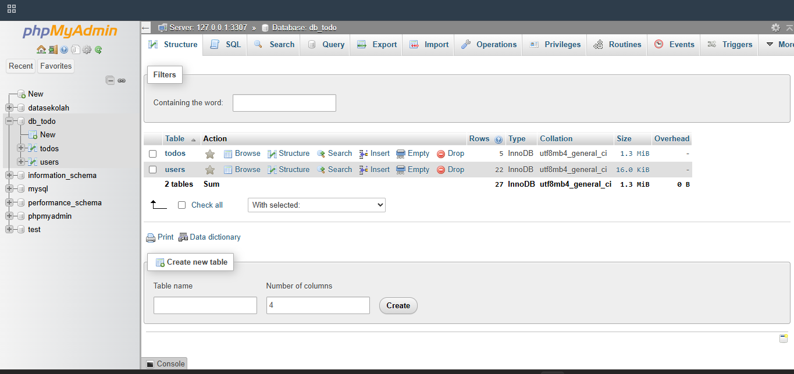  
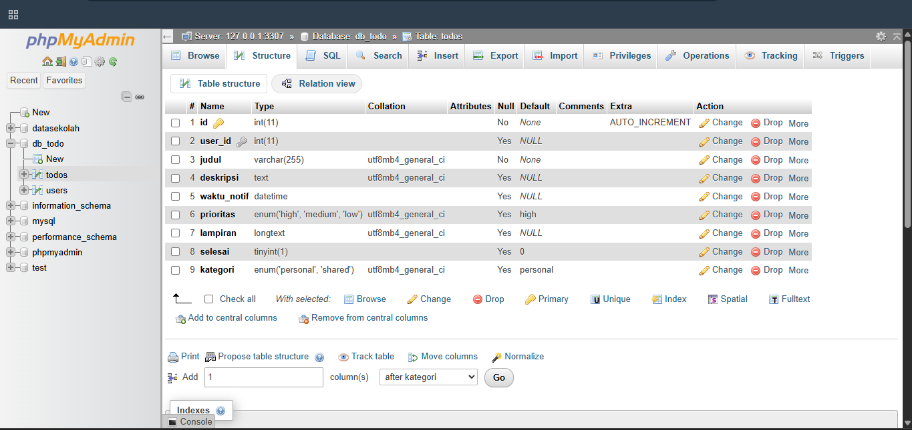  
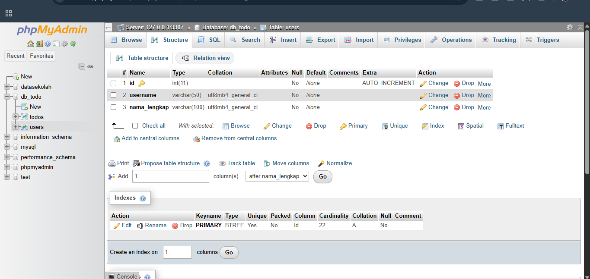  
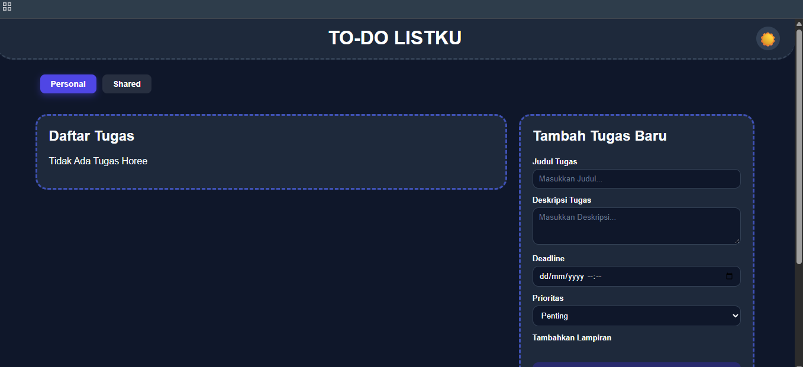  
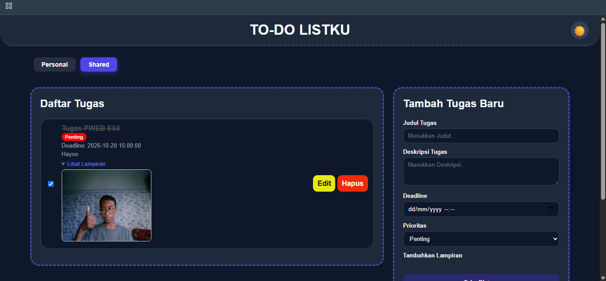  

TERIMA KASIH 

## VERSI 2 - JIKA ADA DETAIL/EDITOR  GAK JADI
- Tampilan Desktop  
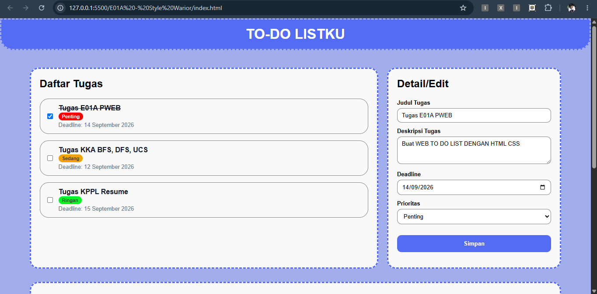
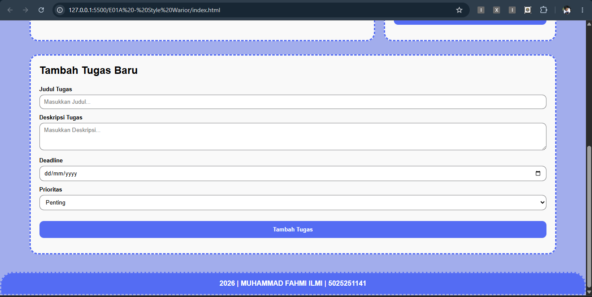

- Tapilan Mobile  
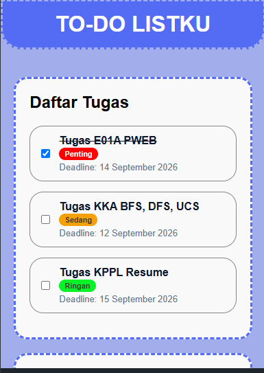  
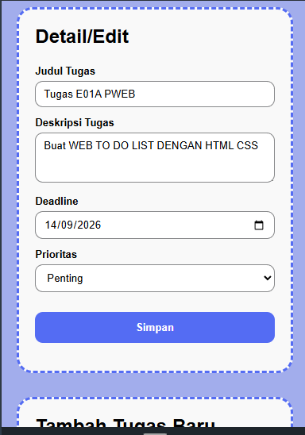
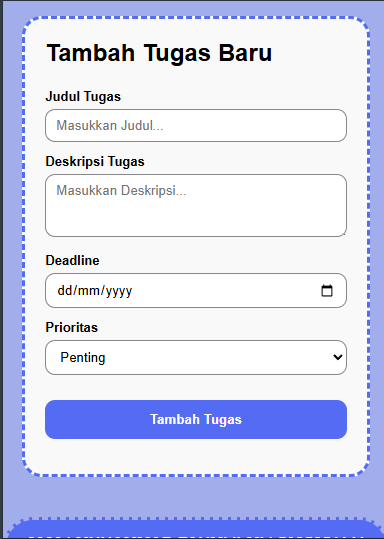