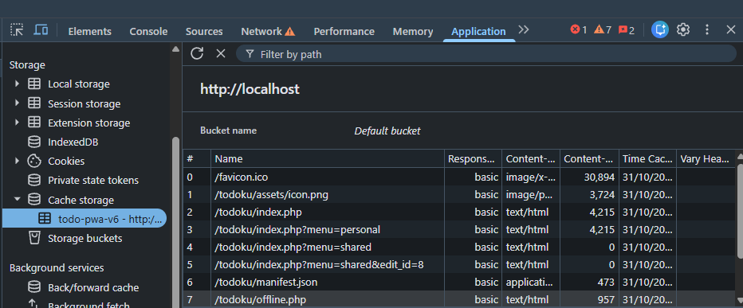
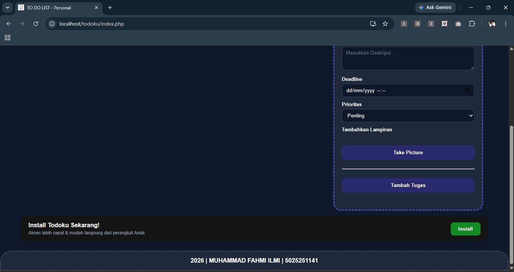
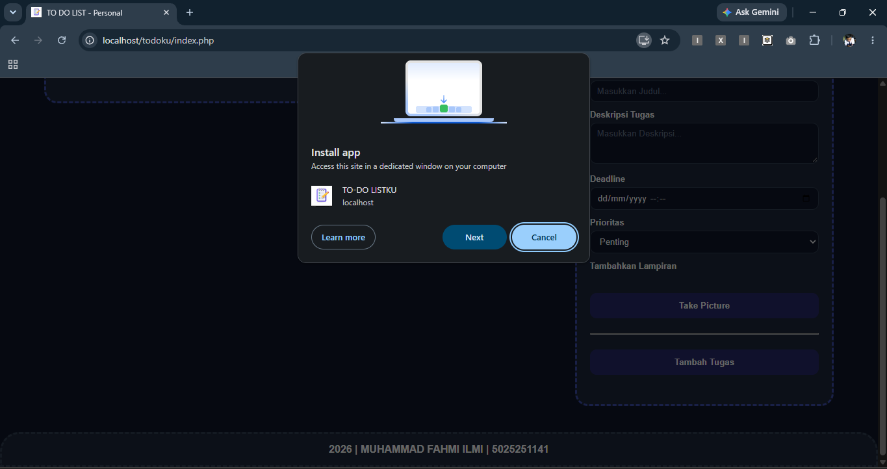
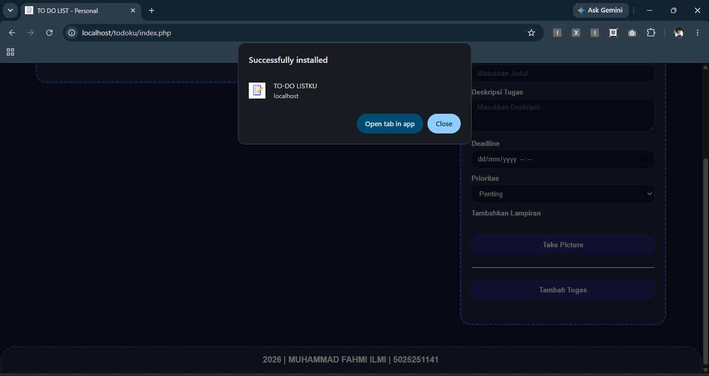
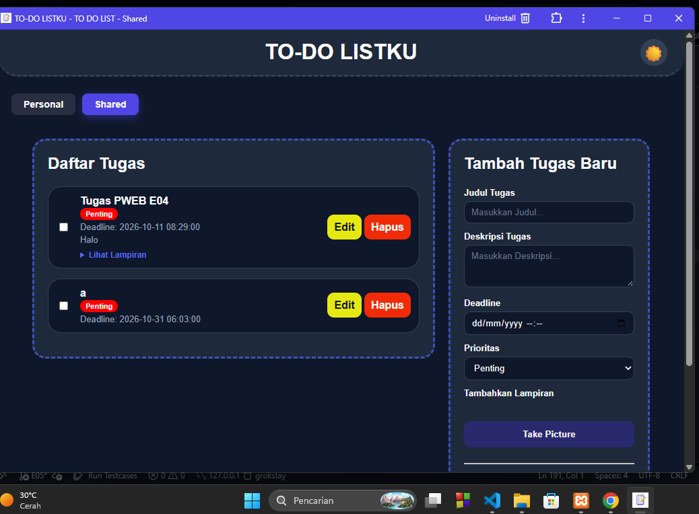
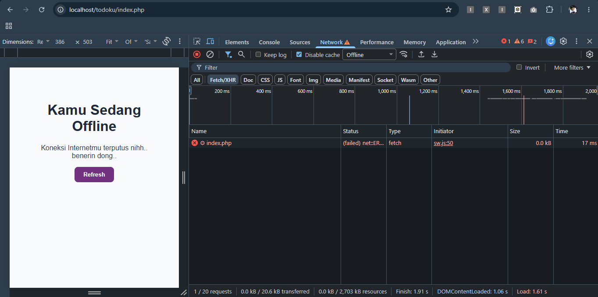

# [E05] The Offline Abyss - Todo List App

Tugas membuat tampilan **Todo List** menggunakan HTML dan CSS sesuai dengan kriteria.

| Nama                | NRP        |  Kelas     |
| ------------------- | ---------- | ---------- |
| Muhammad Fahmi Ilmi | 5025251141 | PWEB A     |  

### 1. Create a web app manifest with icons and link it  
manifest.json  
```json
{
    "name": "TO-DO LISTKU",
    "short_name": "TodoList",
    "start_url": "./index.php",
    "display": "standalone",
    "background_color": "#fff",
    "theme_color": "#4f46e5",
    "icons": [
        {
            "src": "./assets/icon.png",
            "sizes": "192x192",
            "type": "image/png"
        },
        {
            "src": "./assets/icon.png",
            "sizes": "512x512",
            "type": "image/png"
        }
    ]
}
```
header.php  
```php
<?php
$kategori = isset($_GET['menu']) ? $_GET['menu'] : 'personal';
?>
<!DOCTYPE html>
<html lang="id">
<head>
    <meta charset="UTF-8">
    <meta name="viewport" content="width=device-width, initial-scale=1.0">
    <title>TO DO LIST - <?= ucfirst($kategori); ?></title>
    <link rel="stylesheet" href="style.css">
    <link rel="manifest" href="manifest.json">
...
```

### 2. Precache the app shell and an offline page with a Service Worker  
sw.js  
```js
const CACHE_NAME = 'todo-pwa-v6';
const ASSETS_TO_CACHE = [
    './index.php',
    './offline.php',
    './style.css',
    './script.js'
];

self.addEventListener('install', (event) => {
    console.log('Service Worker terinstal.');
    event.waitUntil(
        caches.open(CACHE_NAME).then((cache) => {
            return Promise.all(
                ASSETS_TO_CACHE.map((path) => {
                    return cache.add(path).catch((err) => {
                        console.log('Gagal cache:', path, err);
                    });
                })
            );
        })
    );
    self.skipWaiting();
});

self.addEventListener('activate', (event) => {
    console.log('Service Worker aktif.');
    event.waitUntil(
        caches.keys().then((keys) => {
            return Promise.all(
                keys.map((key) => {
                    if (key !== CACHE_NAME) {
                        return caches.delete(key);
                    }
                })
            );
        })
    );
    self.clients.claim();
});

self.addEventListener('fetch', (event) => {
    const url = new URL(event.request.url);

    if(!url.protocol.startsWith('http')){
        return;
    }

    if (event.request.mode === 'navigate' || (event.request.method === 'GET' && event.request.headers.get('accept').includes('text/html'))) {
        event.respondWith(
            fetch(event.request)
                .then((networkResponse) => {
                    return caches.open(CACHE_NAME).then((cache) => {
                        cache.put(event.request, networkResponse.clone());
                        return networkResponse;
                    });
                })
                .catch(() => {
                    return caches.match('./offline.php') || caches.match('offline.php');
                })
        );
        return;
    }

    event.respondWith(
        caches.match(event.request).then((cachedResponse) => {
            if (cachedResponse) {
                return cachedResponse;
            }
            return fetch(event.request).then((networkResponse) => {
                return caches.open(CACHE_NAME).then((cache) => {
                    cache.put(event.request, networkResponse.clone());
                    return networkResponse;
                });
            }).catch(() => {});
        })
    );
});
```

### 3. Choose a caching strategy per resource  
  
| Jenis Resource | Strategi Caching | Penjelasan & Mekanisme Kerja |
| :--- | :--- | :--- |
| **App Shell & Aset Inti** <br>(`index.php`, `style.css`, `script.js`) | **Cache-First** (Saat Instalasi) | Disimpan ke dalam *Cache Storage* di awal siklus hidup (*install*). Menyediakan performa muat instan tanpa membebani jaringan untuk file yang jarang berubah. |
| **Halaman Navigasi / Konten Dinamis** <br>(Permintaan dokumen HTML/PHP) | **Network-First** + **Offline Fallback** | Sistem memprioritaskan pengambilan data terbaru dari server. Jika jaringan terputus atau gagal, sistem secara otomatis menangkap galat dan mengalihkan tampilan ke `offline.php` dari *cache*. |

### 4. Add an install button  
  
install-btn.php  
```php
<div class="install-nav" id="installContainer" style="display: none;">
    <div class="install-info">
        <h3>Install Todoku Sekarang!</h3>
        <p>Akses lebih cepat & mudah langsung dari perangkat Anda.</p>
    </div>
    <button id="installBtn" class="install-btn">Install</button>
</div>
```
style.css  
```css 
.install-nav {
    max-width: 1200px; 
    margin: 0 auto 20px auto; 
    padding: 15px 20px; 
    display: flex; 
    align-items: center;
    justify-content: space-between;
    gap: 15px;
    background-color: #141414;
    border-radius: 12px;
    color: #fff;
}

.install-info h3 {
    margin: 0 0 4px 0;
    font-size: 16px;
}

.install-info p {
    margin: 0;
    font-size: 12px;
    color: #94a3b8;
}

.install-btn {
    padding: 10px 20px;
    border: none;
    border-radius: 8px;
    background-color: #138b23;
    color: #fff;
    font-weight: 700;
    cursor: pointer;
    white-space: nowrap;
}
```

### Hasil Install PWA  
  
  
  

### 5. Offline  
  
offline.php  
```php
<!DOCTYPE html>
<html lang="id">
<head>
    <meta charset="UTF-8">
    <meta name="viewport" content="width=device-width, initial-scale=1.0">
    <title>Offline Nih...</title>
    <style>
        body {
            font-family: sans-serif;
            text-align: center;
            padding: 50px;
            background: #f8fafc;
            color: #334155;
        }
        h1 {
            color: #1e293b;
        }

        .offline-btn {
            padding: 10px 20px;
            border: none;
            border-radius: 8px;
            background-color: #733280;
            color: #fff;
            font-weight: 700;
            cursor: pointer;
            white-space: nowrap;
        }
    </style>
</head>
<body>
    <h1>Kamu Sedang Offline</h1>
    <p>Koneksi Internetmu terputus nihh.. benerin dong..</p>
    <button class="offline-btn" onclick="window.location.reload()">Refresh</button>
</body>
</html>
```